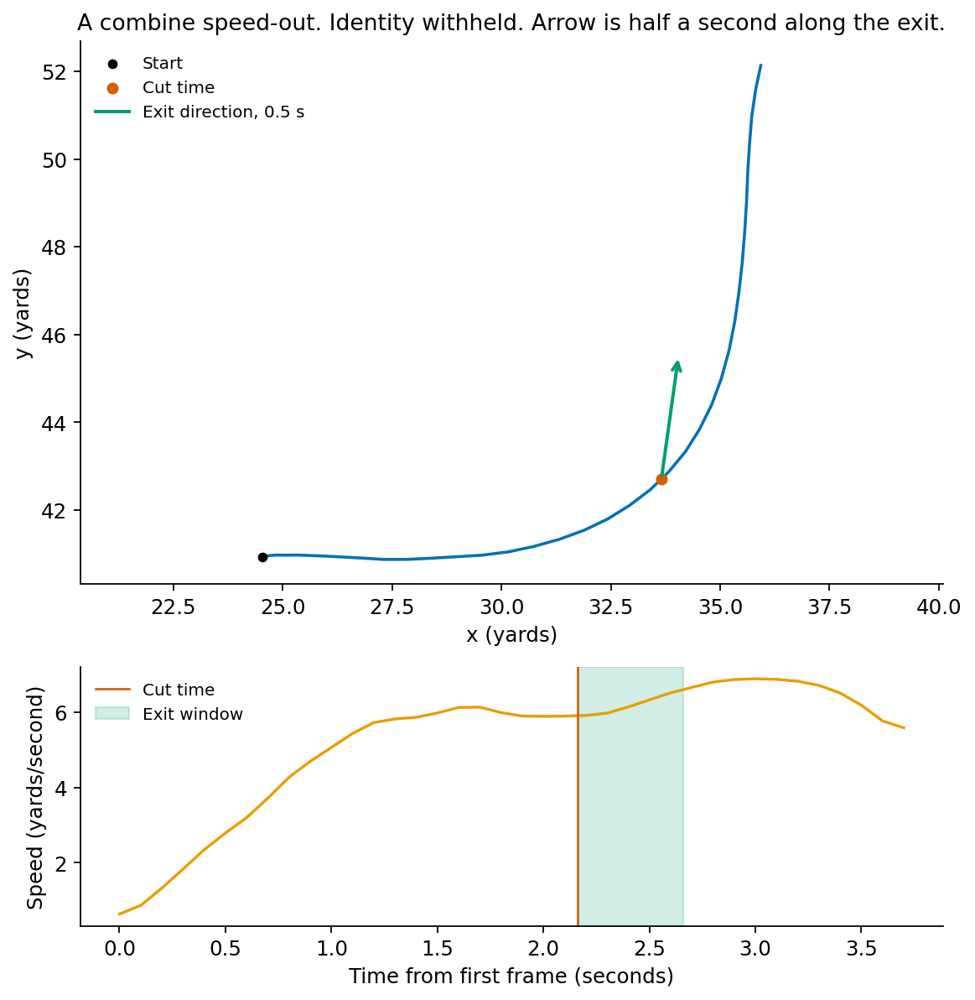
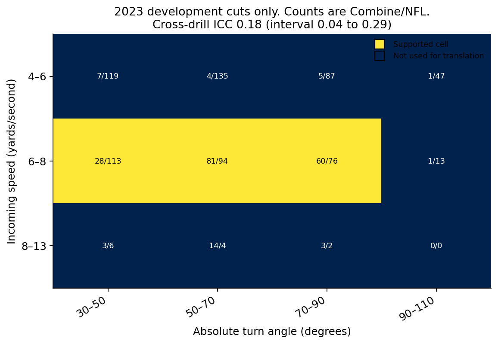
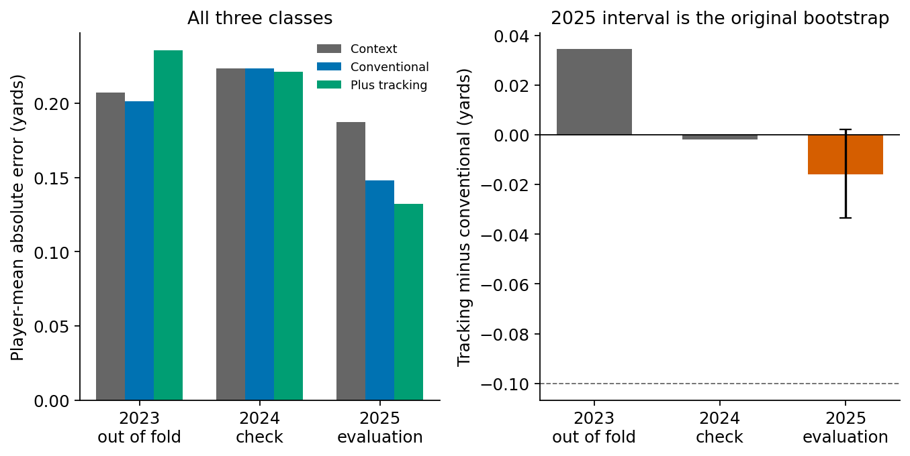

# The Cost of a Cut
## Does a Combine turn predict rookie separation?

Two receivers run similar forties. Can their movement through a Combine turn help a scout distinguish them? We tested the distance a receiver gains along the outgoing direction in the half-second after a turn, adjusted for entry speed, turn angle, and drill. The proposed relationship was simple: a better adjusted exit would predict more rookie-season separation.

This experiment did not establish that relationship. Adding the tracking trait reduced prediction error by 0.016 yards in the 2025 evaluation class, but the uncertainty interval included no improvement. The fitted association was negative, and the corresponding NFL movement measure showed little agreement with the Combine trait. Those findings limit ranking players by this residual. They do not settle whether other cut-related measurements are useful.

## The receivers and the outcome

The dataset contains 106 wide receivers across the 2023–25 classes. We studied regular-season routes in each player's rookie year. Eligible plays had a forward pass, a recorded separation label, no nullifying penalty, and a route in the specified analysis set. Screens and rare wheel/angle labels were excluded. Receivers needed at least 20 eligible routes for the primary evaluation.

| Draft class | Roster receivers | Eligible routes | Modeled receivers | Modeled routes |
| --- | ---: | ---: | ---: | ---: |
| 2023 | 38 | 6,280 | 28 | 6,279 |
| 2024 | 31 | 4,368 | 21 | 4,324 |
| 2025 | 37 | 3,605 | 19 | 3,552 |

*Table 1. The modeling sample after the route-count requirement. These are player-route observations, not independent prospects.*

The outcome is the supplied distance to the nearest defender when the pass is thrown. It is available on targeted and untargeted routes for completions, incompletions, and interceptions, and unavailable on sacks and scrambles. Missing outcomes were excluded rather than set to zero. Game tracking follows the prospect cohort, so we did not reconstruct separation from an incomplete set of defenders.

The sample describes receivers who played enough eligible routes. Of the 18 receivers excluded from the 2025 class by the route requirement, 13 were undrafted; only one of the 19 modeled receivers was undrafted. Results therefore cannot be extended directly to prospects who rarely played. The rule-selected examples also depend on who later played enough routes. They are not an unconditional pre-draft screen.

## Measuring the exit

For each detected turn, the reference time is the midpoint of heading change between the incoming and outgoing segments. Exit distance is the displacement over the following 0.5 seconds projected onto the outgoing direction. It measures movement along the route, not distance from a defender.

*Figure 1. An illustrative Combine speed-out. The turn reference and exit window define the measurement; the trajectory does not identify foot placement or joint mechanics.*

A training-fitted ridge model estimates expected exit distance from entry speed, turn angle, their interaction, and drill family. The observed-minus-expected difference is the cut-exit residual. When one attempt contains several cuts, those residuals are averaged first. The player trait is then the median of qualifying attempt residuals, and each player receives equal weight. Fewer than two attempts leaves the trait unavailable. The primary families were speed-out, slot-sail, dagger, post-corner, and qualifying slant attempts.

The recorded protocol required a 30–110-degree turn, entry speed of at least four yards per second, and usable tracking around the reference time. The 2023–24 extract contains 406 qualifying Combine cuts across 69 roster receivers. That count is the feasibility population. Of those cuts, 295 belong to the 49 receivers in the performance model, and 321 fall in the final common-support cells. The trait uses every primary-family cut, not only the supported cells. Support restricts the translation comparison.

The 2023 out-of-fold ICC of 0.18 (interval 0.04–0.29) is cross-drill consistency. Most drills occur once. The within-receiver residual SD is 0.28 yards. The SD of receiver means is 0.18 yards and still includes estimation error; the latent between-receiver SD from the same ANOVA is 0.13 yards. Eighteen same-family groups are too few to estimate a detectable-change threshold, and no yardage cutoff is used as a coaching rule.

Out-of-fold attempt residuals are not centered within every drill or speed band. Speed-out attempts average −0.19 yards, and the fastest speed band averages +0.42 yards. Putting speed and angle in the ridge formula did not fully remove those demands.

*Figure 2. Support calculated on 2023 cuts, the map used for the 2024 translation check. Cell labels give Combine/NFL counts. Supported cells are the light squares. Final training uses a separate 2023–24 support calculation.*

NFL cuts were measured only when the half-second window finished before the throw and any recorded catch or contact. A throw before that window ends makes the cut unavailable. About 10–11% of tracked forward passes yielded a qualifying cut. This is detector and window coverage, not an estimate of how often receivers change direction.

After evaluation, 30 Combine attempts and 30 NFL routes from the stratified gallery were opened one by one, with names, draft slot, and separation hidden. Because the sample mixes kept and rejected cases, these are agreement counts, not precision or recall. Among the 30 Combine examples, 15 marks were the intended break and 2 rejections fit a gradual path; 2 rounded breaks were missed and 4 marks sat on the wrong phase, with 7 ambiguous or indeterminate. Among the 30 NFL examples, 9 marks were the intended break and 2 screen rejections fit; 2 outs were missed and 7 marks were a release or the wrong phase, with 10 ambiguous or indeterminate. Speed-outs and daggers were usually the intended turn. Slot strikes were often marked after the plant, and go routes often marked a release.

The two analyses use different populations. Performance prediction covers the eligible route set, including go routes. The movement check uses measurable cuts inside shared demands.

## Testing additional information

The 2023 class supplied development and player-grouped out-of-fold predictions. The 2024 class provided a chronological development check. The recorded recipe was then fitted on 2023–24 and evaluated once on 2025. The project log places protocol and model freezing before that evaluation. There is no public preregistration.

All three models include route family, coverage, cushion, down and distance, field position, formation, alignment, and motion. The conventional model adds body measurements, age, forty and ten-yard times, vertical, broad jump, three-cone, and shuttle. Missing tests are imputed inside the training fold, with missingness indicators. The tracking model adds the cut-exit trait. For 2023 out-of-fold scores, demand fits and penalty choices stay inside the training players. The frozen penalty is chosen on all 2023–24 training players, then the model is refit. The 2025 class was not used to tune either step.

Training gives each receiver equal total weight across their routes. The primary score averages the absolute difference between each receiver's mean observed and mean predicted separation. These predictions condition on the routes actually observed. They are not common-context prospect projections. NFL movement traits and receiving outcomes are not prospect predictors.

The original comparison uses independently selected penalties: 1.0 for the conventional model and 0.3 for the tracking model. That comparison is a difference between two trained pipelines. A player's prediction change also includes refitted shared terms.

## What the evaluation showed

For the 19 receivers in 2025, context alone produced player-mean absolute error of 0.187 yards. Conventional measurements reduced it to 0.148; adding tracking reduced it to 0.132.

The tracking-minus-conventional difference was −0.0158 yards. The paired bootstrap interval, from 2,000 resamples of the 19 receivers, was −0.0333 to +0.0022 yards. It includes no improvement and is conditional on the fitted pipelines.

*Figure 3. Player-mean absolute error. The right-hand interval is the original 2025 paired bootstrap of receivers. The dashed line is this project's 0.10-yard target. Negative differences favor tracking. The 2023 and 2024 results are development checks, not two extra final tests.*

Tracking increased error by 0.034 yards in the 2023 out-of-fold results and reduced it by 0.002 in the 2024 check. The analyst-chosen target was a 0.10-yard reduction in player-mean error. The 2025 estimate falls short of that target. The target is specific to this project.

Route-level errors differ from player averages: context alone achieved 1.420 yards, conventional testing 1.428, and tracking 1.425 in 2025. Conventional testing's player-mean advantage over context was 0.006 yards in 2023, about zero in 2024, and 0.039 in 2025. On 2025 man-coverage routes, both Combine models were worse than context alone. This experiment does not establish a general advantage for either set of prospect measurements.

One training standard deviation of the trait, about 0.20 yards, was associated with 0.038 yards less predicted separation. That conditional association runs against the proposed direction.

The Combine-to-NFL movement correlations were −0.31 for 21 receivers in 2024 and 0.08 for 20 in 2025, on the restricted movement sample.

A post-evaluation diagnostic put both models on one penalty, chosen by grouped folds of the 2023–24 training receivers only. The chosen penalty was 1.0. On those development folds the tracking model was 0.003 yards worse. Applied afterward to 2025, the same penalty reduced error by 0.008 yards, from 0.148 to 0.140. That retrospective number was not used to select the penalty, and it is not a second holdout test.

## What the player examples mean

The protocol selected Jaylin Noel and Jaylin Lane by the disagreement between their conventional and tracking projections within a forty-time band. Noel's observed mean separation was 3.224 yards. Conventional predictions averaged 3.195 on his routes, closer than tracking's 3.142. Lane averaged 3.180; tracking's 3.161 was closer than conventional's 3.099.

Those gaps are not the trait term alone. On each model's own scaling, Noel's tracking prediction is 0.052 yards lower: the trait term is −0.046, shared features +0.084, and the intercept −0.090. Lane's prediction is 0.062 yards higher. Zeroing only his trait lowers the tracking prediction by 0.081, so the negative residual does raise his forecast, while shared-coefficient changes add 0.072 and the intercept moves the other way by 0.090. The parts sum to the total. Dont'e Thornton, chosen after evaluation as the largest tracking miss, averaged 2.541 yards against predictions near 2.91–2.94. His trait term is −0.016 yards.

## Why the trait did not travel

Two development checks were written down before they were run. Leaving out one well-represented drill family at a time left player ranks highly correlated with the full trait, from 0.81 to 0.91 among 69 receivers. Pooling did not scramble the order. It also did not remove the family mean residuals above. On the same 49 development receivers, only 456 of 10,603 eligible routes contained a supported NFL cut, though 48 receivers had at least one. The rank correlation of the trait with mean separation was −0.18 on all routes and −0.38 on those cut-bearing routes. Restricting the endpoint to measured cuts did not uncover a positive relationship, and routes without a measured cut were not scored as zero ability. Neither check changes the original 2025 result.

## A practical boundary

This residual should not be a receiver ranking on the present evidence. Its cross-drill consistency is limited, the demand adjustment is incomplete, NFL agreement is unstable, and the additional prediction result is uncertain across 19 players.

A later study could repeat one drill at a matched speed and angle before setting any progress rule. Nineteen evaluation receivers and sparse comparable cuts constrain this one. A movement difference still needs consistent measurement, NFL translation, and additional decision value before it becomes a scouting grade.
