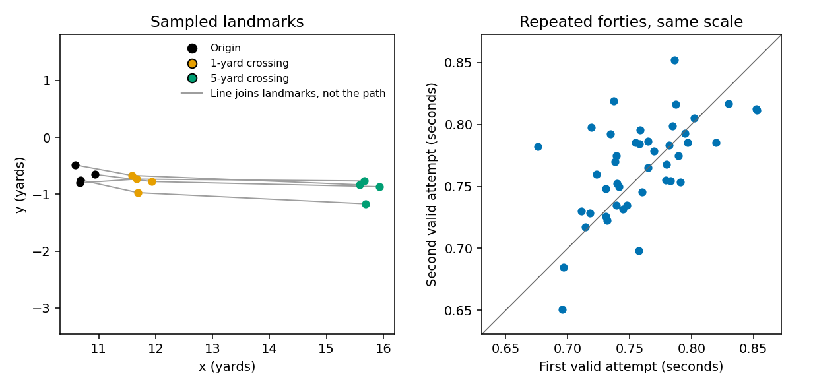
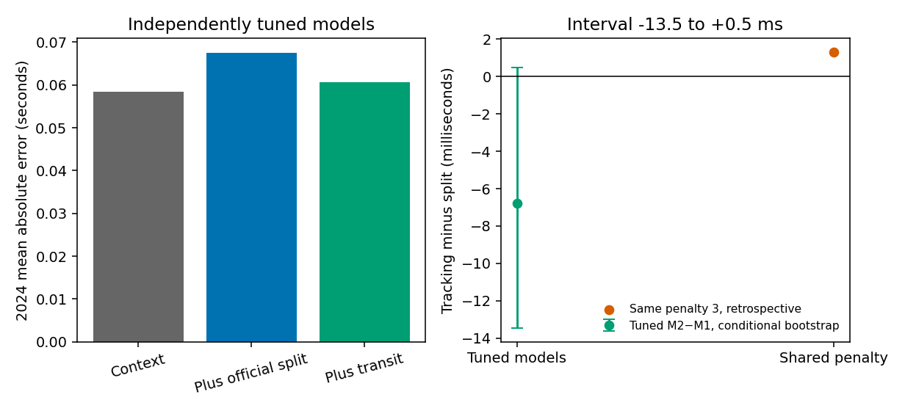
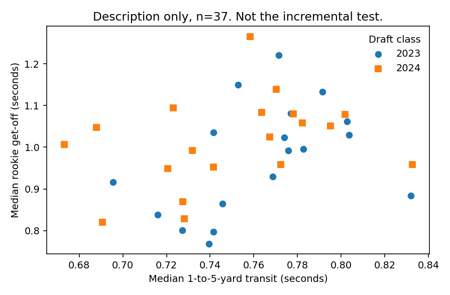

# A repeatable forty start, and no get-off grade

Defensive linemen leave a stance twice at the Combine and then get timed getting off the ball as rookies. We asked whether the time they take to go from one yard to five yards on the forty, measured from tracking, adds anything to a prediction of that get-off once the official 10-yard split and observed deployment are known.

We did not establish that the tracking interval adds useful prediction of rookie get-off beyond the official split and observed deployment. The transit is reasonably repeatable. That is a finding about this measurement. It is not a claim that Combine testing is irrelevant, and it is not a claim that deployment caused the get-off times.

## What was measured

This study uses the 2023 and 2024 classes only. The players are defensive ends, tackles, and nose tackles.

The outcome is each player's median `player_get_off` in the rookie regular season. The competition data dictionary defines that field as the time, in seconds, from the ball snap until the defensive rusher moves forward across the line of scrimmage ([NFL Big Data Bowl 2027 data](https://www.kaggle.com/competitions/nfl-big-data-bowl-2027/data), `player_play.csv`). The competition host has also said the value is missing when the player never crosses the line of scrimmage. We left those plays missing rather than treating them as zero. Sacks and scrambles were not removed. A player needed at least eight recorded get-offs. The player value is a median over the plays he actually played, so the predictions are conditional on that deployment. They are not a claim that the deployment produced the times.

That clock is not a stationary forty start. The forty interval begins only after the player has already reached one yard from a verified standing position, and it ends at five yards. There is no snap and no line of scrimmage, and nobody is blocking him. Get-off begins at the snap and ends at the line. A difference between the two is a difference between those definitions, not evidence that a training change would move get-off.

The official 10-yard split is the conventional baseline. On each forty, the origin is the median position of the opening frames slower than 2 yards per second, not the first timestamp. The tracking feature is the interpolated time at 5 yards minus the time at 1 yard, along the direction of the run. The player value is the median of valid attempts. No clock offset was used to force tracking onto the official split.

Forty-two linemen had a rookie play. Forty had eight get-offs. Three lacked an official split. All 94 forty attempts produced a transit, so tracking removed no one. The models share 37 players: 18 in 2023 and 19 in 2024.

*Figure 1. The left panel marks the origin, the 1-yard crossing, and the 5-yard crossing. Gray segments join those landmarks. They are not the tracked path. The right panel uses the same scale on both axes. Forty-four players have two valid attempts. Thirty-two of the 37 modeling players are in that repeat set; the other twelve repeats are linemen who were not in the model sample.*

The second attempt was 0.007 seconds slower on average. The repeat-attempt ICC is 0.59. The within-player standard deviation is 0.025 seconds, and the latent between-player standard deviation is 0.030 seconds. Shifting the origin by a quarter of a yard moves the transit by a median of 0.032 seconds. Those statements are about this sensor interval only.

## What was predicted

Each model has one row per player. Context uses combine weight, the share of snaps lined up at edge rather than inside, and median depth at the snap. Depth uses the snap frame and the line of scrimmage, not later movement. The second model adds the official split. The third adds the transit. Penalties were chosen on 2023 only.

| Model | 2023 penalty | 2024 error (seconds) |
| --- | ---: | ---: |
| Context | 0.3 | 0.058 |
| Context plus official split | 1 | 0.067 |
| Context plus split and transit | 3 | 0.061 |

*Table 1. Independently tuned models. Error is the mean absolute difference, in seconds, across the 19 players in 2024.*

The tracking model beats the split model by 0.0068 seconds on that tuned comparison. A bootstrap that resamples the 19 fitted predictions, and does not refit, runs from −13.5 to +0.5 milliseconds. The positive end is above zero, so the interval includes no gain. The bars in Figure 2 are the three mean errors. They do not have intervals. The interval applies only to the paired difference, and only conditional on those predictions. It does not cover uncertainty in the measurement or in the choice of penalty.

*Figure 2. Left: the original three-model comparison. Right: tracking minus split. The green interval is the conditional bootstrap, from −13.5 to +0.5 milliseconds, drawn against zero. The orange point is the retrospective shared-penalty difference, not a second primary test.*

The 0.0068-second gap is not the transit alone. The split model was penalized at 1 and the tracking model at 3. Refitting the split model at 3 is a diagnostic. It is not a new primary result. At that shared penalty, 2024 error is 0.0594 seconds without the transit and 0.0607 seconds with it. Adding the measurement slightly increases error.

A nested leave-one-player-out on all 37 players agrees with that caution. Context error is 0.065 seconds, the split model 0.070, and the tracking model 0.072. The chronological gap is not evidence of incremental value.

The fitted 2023 coefficient on the transit is +0.004 seconds of get-off per training standard deviation. The hypothesized direction is positive. A bootstrap that refits 2023 at the frozen penalty, without choosing the penalty again, runs from −0.034 to +0.040.

*Figure 3. Description of the 37 development players, with 2023 and 2024 marked separately. This scatter is not the incremental prediction test.*

The official split does rank with get-off: Spearman 0.35 in 2023, 0.59 in 2024, and 0.45 pooled. Slower splits go with slower get-offs in that description. Putting the split into the 2024 prediction still raised error relative to context alone. A descriptive association and a failed incremental prediction are different statements.

## What these data justify

These data do not justify adding this sensor interval to a rookie get-off scouting grade. They also do not justify telling a player to change his early sprint in order to change his get-off. The transit can be measured again on a second attempt with moderate agreement. That is as far as the evidence goes. No threshold for a useful gain was set after seeing the errors.

## Appendix: choices that are not part of the 2024 result

The existing evaluation rule asks for at least 20 untouched prospects before a confirmatory class is admitted. Seventeen matched 2025 linemen fall short of that count, so this study does not use 2025. The headcount is not, by itself, a claim that the class is contaminated.

An earlier measurement check, not an NFL association, found that a tracking time to 10 yards does not match the official split. That is why this paper uses the official split as the baseline and does not shift the 1-to-5-yard clock onto it.
