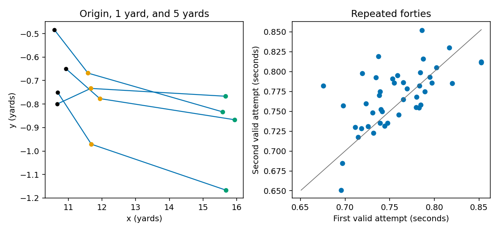
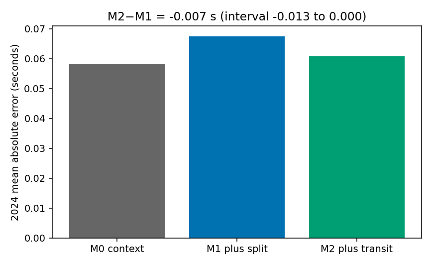
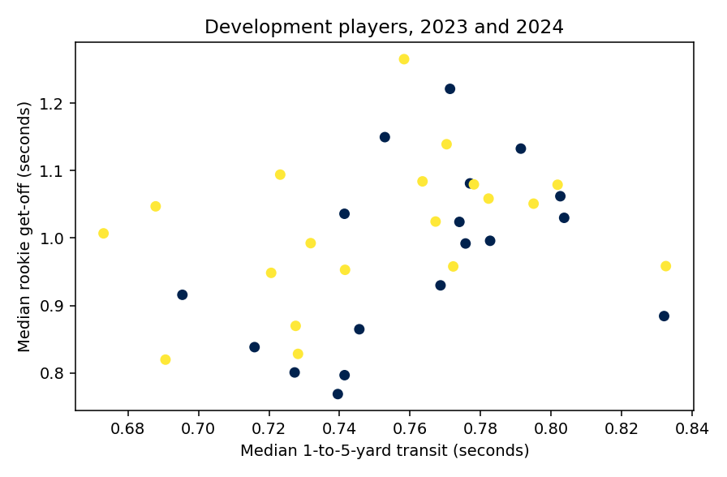

# A repeatable forty start, and no get-off grade

Defensive linemen leave a stance twice at the Combine and then get off the ball all season. We asked whether the time they take to go from one yard to five yards on the forty, measured from tracking, tells us anything about rookie get-off once the official 10-yard split is already known.

It does not. The transit is reasonably repeatable. It did not establish a useful improvement in predicting get-off. That is a finding about this measurement, not a claim that Combine testing is useless, and not a claim that how a lineman was deployed caused his get-off.

## What was measured

The players are the 2023 and 2024 defensive ends, tackles, and nose tackles. The outcome is the median of the supplied `player_get_off` times in the rookie regular season, in seconds. Get-off mixes movement, the snap, the stance, and the plays he actually faced. It is not pure acceleration, and it is not sacks or expected points. Plays without a get-off time were left missing. Sacks and scrambles were not removed. A player needed at least eight recorded get-offs.

The official 10-yard split is the conventional baseline. The tracking feature is not a second copy of that split. On each forty, the origin is the median position of the opening frames slower than 2 yards per second, not the first timestamp. The feature is the interpolated time at 5 yards minus the time at 1 yard, along the direction of the run. The player value is the median of valid attempts. No clock offset was used to force the tracking time onto the official split.

Forty-two linemen had a rookie play. Forty had eight get-offs. Three lacked an official split. All 94 forty attempts produced a transit, so tracking removed no one. The models share 37 players: 18 in 2023 and 19 in 2024. The 2025 class was not used. Seventeen matched 2025 linemen would have failed the existing rule of 20 evaluation players. That headcount is why 2025 stayed closed. It is not, by itself, evidence that the class is contaminated.

*Figure 1. Four attempts, chosen by player identifier, with the origin and both crossings. The right panel compares the two valid attempts. Forty-four players contribute to that comparison.*

The second attempt was 0.007 seconds slower on average. The repeat-attempt ICC is 0.59. The within-player standard deviation is 0.025 seconds, and the latent between-player standard deviation is 0.030 seconds. Shifting the origin by a quarter of a yard moves the transit by a median of 0.032 seconds. Those statements are about this sensor interval only. They do not make the official split unreliable. An earlier check had already shown that a tracking clock to 10 yards does not match the official split.

## What was predicted

Each model has one row per player. The context model uses combine weight, the share of snaps lined up at edge rather than inside, and median depth at the snap. Depth uses the snap frame and the line of scrimmage, not later movement. The second model adds the official split. The third adds the transit. Penalties were chosen on 2023 only. The 2024 errors below are from that fit.

| Model | 2023 penalty | 2024 error (seconds) |
| --- | ---: | ---: |
| Context | 0.3 | 0.058 |
| Context plus official split | 1 | 0.067 |
| Context plus split and transit | 3 | 0.061 |

The tracking model beats the split model by 0.0068 seconds. A bootstrap that resamples the 19 predictions, and does not refit, runs from −0.0135 to +0.0005 seconds. It includes no gain. It is also conditional on those fitted predictions. It does not cover every uncertainty in the measurement or in the choice of penalty.

*Figure 2. Mean absolute error on the 19 players in 2024. The interval in the title is the paired bootstrap of tracking minus split. Negative would favor tracking.*

The 0.0068-second gap is not the transit alone. The split model was penalized at 1 and the tracking model at 3. Refitting the split model at 3, the penalty already selected for the tracking model, is a diagnostic. It is not a new primary result. At that shared penalty, 2024 error is 0.0594 seconds without the transit and 0.0607 seconds with it. Adding the measurement slightly increases error. The independently tuned comparison stays the historical development result, and it cannot be read as the sensor’s contribution.

A nested leave-one-player-out on all 37 players agrees with that caution. Context error is 0.065 seconds, the split model 0.070, and the tracking model 0.072. The more flattering chronological gap is not the one we keep as evidence of incremental value.

The fitted 2023 coefficient on the transit is +0.004 seconds of get-off per training standard deviation. The hypothesized direction is positive. A bootstrap that refits 2023 at the frozen penalty, without choosing the penalty again, runs from −0.034 to +0.040. The association is too small and too uncertain to use.

*Figure 3. Each point is one of the 37 development players. Color marks draft class. This is a description, not the incremental test.*

The official split does rank with get-off: Spearman 0.35 in 2023, 0.59 in 2024, and 0.45 pooled. Slower splits go with slower get-offs in that description. Putting the split into the 2024 prediction still raised error relative to context alone. A descriptive association and a failed incremental prediction are different statements. Leaving out any one 2024 player leaves the tuned tracking-minus-split gap between about −0.008 and −0.005 seconds. Interior linemen account for more of it than edge players. The nose-tackle group is one player. None of those slices is a grade.

## What a coach can take from this

The early forty transit can be measured again on a second attempt with moderate agreement. It did not establish that it improves a prediction of rookie get-off beyond the official split and the small context set. The predictions are conditional on the plays those rookies actually played. They are not forecasts from the Combine alone, and they are not evidence that a different stance or a different drill would have changed get-off or pressure.

No threshold for a useful gain was set after seeing the errors. No scouting rule follows. The 2025 class was not opened to look for one.
